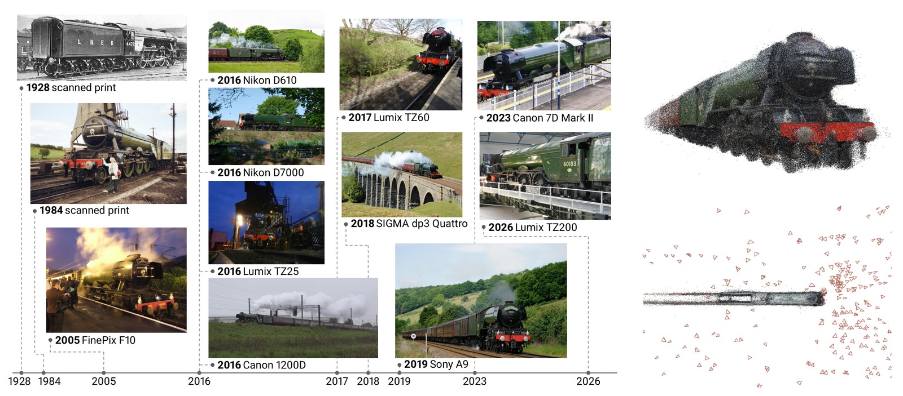

<h1 align="center">Trainspotting: Learning Object-Centric 3D Reconstruction from Found Photos</h1>

<p align="center"><a href="https://hanyuc.com/">Hanyu Chen</a> &middot; <a href="https://www.cs.cornell.edu/~snavely/">Noah Snavely</a><br>Cornell University</p>

<p align="center"><a href="https://arxiv.org/abs/2611.06849">Paper</a> &nbsp;&middot;&nbsp; <a href="https://hanyuc.com/trainspotting/">Project page</a> &nbsp;&middot;&nbsp; <a href="https://huggingface.co/datasets/hanyucc/Trainspotting">Dataset</a> &nbsp;&middot;&nbsp; <a href="https://huggingface.co/spaces/hanyucc/spotter-demo">Demo</a> &nbsp;&middot;&nbsp; <a href="https://huggingface.co/hanyucc/spotter">Checkpoint</a></p>

<p align="center"></p>

This repository contains

| folder | contents | license |
|---|---|---|
| `spotter/` | the Spotter model (inference), weight loading | FAIR Noncommercial Research License (`LICENSE`) |
| `demo/` | Gradio demo and the inference helper | FAIR Noncommercial Research License |
| `evaluation/` | the Trainspotting held-out evaluation protocol, per-sample results of every model in the paper | MIT (`evaluation/LICENSE`) |
| `tests/` | smoke test against stored reference outputs | MIT |
| `reconstruction/` | the reconstruction pipeline: cameras, depth and object masks from a photo collection and a text prompt, with its own installation (`reconstruction/README.md`) | MIT (`reconstruction/LICENSE`) |

## Installation

```bash
git clone https://github.com/hanyucc/trainspotting.git
cd trainspotting
pip install -e .            # add [demo] for the Gradio demo: pip install -e ".[demo]"
```

PyTorch 2.3 or newer with CUDA. The weights (4.4 GB, float32) download from the Hub on first use.

## Quick start

```python
import torch
from spotter import load_spotter
from spotter.utils.load_fn import load_and_preprocess_images

model = load_spotter(device="cuda")                    # or load_spotter("spotter.safetensors")
images = load_and_preprocess_images(["a.jpg", "b.jpg", "c.jpg"]).cuda()   # (S, 3, H, W) in [0, 1]
with torch.inference_mode():
    pred = model(images)

pred["extrinsics"]   # (1, S, 3, 4)  OpenCV camera-from-world, in the frame of the first photo
pred["intrinsics"]   # (1, S, 3, 3)  for the preprocessed resolution
pred["depth"]        # (1, S, H, W, 1)
pred["object_mask"]  # (1, S, H, W)  probability that a pixel belongs to the object
```

`demo/inference.py` shows how to unproject the depth into a point cloud; `python demo/app.py` starts the
Gradio demo locally (`--checkpoint` for local weights). The photos of one object go in together; the model was
trained with 2 to 24 views per object.

## Evaluation on Trainspotting

The held-out set has 1,000 objects. Each contributes one connected 4-view sample and, when it has at least
16 photos, one connected 16-view sample: 1,635 samples, listed in `evaluation/samples/eval_samples.tsv`
(image ids in evaluation order; the first is the reference view). See `evaluation/README.md` for the metrics.

```bash
# held-out objects only (about 1,000 archives) from the dataset repository
python -c "from huggingface_hub import snapshot_download; snapshot_download('hanyucc/trainspotting', repo_type='dataset', allow_patterns=['eval/*.tar.gz'], local_dir='trainspotting_data')"
mkdir -p trainspotting_data/held_out && for f in trainspotting_data/eval/*.tar.gz; do tar xzf "$f" -C trainspotting_data/held_out; done

python evaluation/evaluate.py --data-root trainspotting_data/held_out --model spotter --out evaluation/results/spotter_rerun.csv
python evaluation/tables.py evaluation/results/*.csv              # the paper's Table 4
python evaluation/tables.py evaluation/results/*.csv --by regime   # by fixed / roaming / instance-pooled
```

Per-sample results of the paper's models are in `evaluation/results/` (`spotter`, `vggt_omega`, `vggt`, `pi3`,
`da3`, `mapanything`), so a new method only needs its own run. To evaluate another model, write an adapter
(see `evaluation/adapters/__init__.py`) and pass it with `--model path/to/adapter.py`.

| model | Acc ↓ | Comp ↓ | AbsRel ↓ | δ<1.03 ↑ | AUC@5 ↑ | AUC@30 ↑ |
|---|---|---|---|---|---|---|
| VGGT | 2.38 | 8.08 | 0.160 | 32.4 | 11.5 | 44.1 |
| π³ | 2.33 | 6.22 | 0.162 | 34.7 | 12.5 | 46.4 |
| Depth Anything 3 | 2.22 | 12.17 | 0.189 | 32.1 | 10.1 | 29.4 |
| MapAnything | 2.20 | 7.75 | 0.206 | 26.6 | 5.3 | 33.1 |
| VGGT-Ω | 1.84 | 12.68 | 0.201 | 28.1 | 7.2 | 25.0 |
| Spotter | 1.22 | 1.15 | 0.071 | 53.3 | 44.2 | 81.2 |

Point-map accuracy and completeness in percent of the object extent after similarity alignment and ICP; depth
AbsRel and inlier ratio after one scale per sample; camera AUC over all view pairs.

## Smoke test

```bash
python tests/test_smoke.py            # runs the model on four example photos and checks against tests/reference/
```

## License

`spotter/` and `demo/` are derived from [VGGT-Ω](https://github.com/facebookresearch/vggt-omega) and are
distributed, like the Spotter weights, under the FAIR Noncommercial Research License (`LICENSE`): noncommercial
research use only. `evaluation/`, `tests/` and `reconstruction/` are MIT licensed, except `evaluation/preprocess.py`, which is
adapted from VGGT and carries its license, and the CasDiffMVS and ViGeo code in `reconstruction/trainspotting_recon/vendor/`, which
keeps its Apache 2.0 license. The example photos in `demo/examples/` keep their Wikimedia
Commons licenses (`ATTRIBUTION.md`).

## Citation

To follow.
